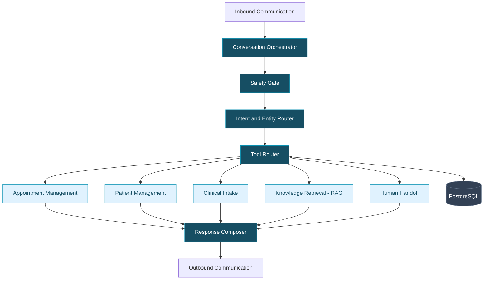

# Clinic Call Center — Multi-Agent Workflow Prototype

**Experimental side project · Work in progress · n8n / PostgreSQL / OpenAI**

An exploratory project by Parham Soufizadeh to learn how coordinated AI-assisted workflows could support clinic call-center and reception operations. The repository contains the selected V4 n8n workflow exports, not a finished call-center product or a native Python agent framework.

## Development disclosure

OpenAI ChatGPT was used extensively to assist in designing, generating, refining and troubleshooting the workflow code and logic. This was a hands-on learning and experimentation phase; the code was not developed independently by me. The repository documents an ongoing exploration of multi-agent orchestration and workflow automation rather than a claim of independently authored production software.

## Architecture

The system explores a modular multi-agent architecture for clinic operations, conversation management, and workflow automation.

*Conceptual architecture of the experimental multi-agent workflow system.*

## Repository layout

| Directory under `workflows/` | Scope |
|---|---|
| `00_SETUP`, `01_BOOTSTRAP` | Database setup and migrations |
| `02_ENTRYPOINTS`, `05_CONVERSATION` | Inbound gateway, orchestration and routing |
| `05_DOMAIN_APPOINTMENT`, `05_PATIENT` | Scheduling and patient operations |
| `05_CLINICAL`, `05_DOMAIN_SUPPORT` | Experimental intake, retrieval and support |
| `05_COMMUNICATION`, `05_DOMAIN_HANDOFF` | Messaging, consent and human escalation |
| `03_SCHEDULERS`, `04_WORKERS` | Background processing and maintenance |
| `06_ADMIN_PLATFORM`, `06_ADMIN_OBSERVABILITY` | Administration, security and operational monitoring |
| `07_TESTS` | Mock adapters and integration-test workflows |

## Local experimentation

Use a disposable n8n instance and isolated PostgreSQL database with synthetic records only. Import workflows manually, assign local credentials, configure webhook URLs and replace calendar placeholders before testing. Follow the migration order in [the setup guide](docs/original-setup-guide-fa.md) and the [import manifest](docs/import-manifest-fa.md). These original Persian guides describe the experimental V4 configuration. Keep real AI workflows 106A/106D inactive in mock mode and use 119A/119B instead; they share endpoints. Do not enable outbound messaging, schedulers, clinical workflows or calendar integrations against live services. Test workflow references after import.

## Status and limitations

This is not production-ready, not a medical device, and not intended for clinical diagnosis, triage or treatment decisions. Clinical intake, safety gates and human escalation are experimental and have not been clinically or independently security validated. No claim of successful end-to-end execution is made for this sanitized release. Voice/telephony integration is not demonstrated by this repository. No live patient data or credentials are intended for distribution. Use only authorized synthetic test data and review applicable privacy and security requirements before any future deployment.

## Contact

Parham Soufizadeh — [LinkedIn](https://www.linkedin.com/in/parham-soufizadeh)
